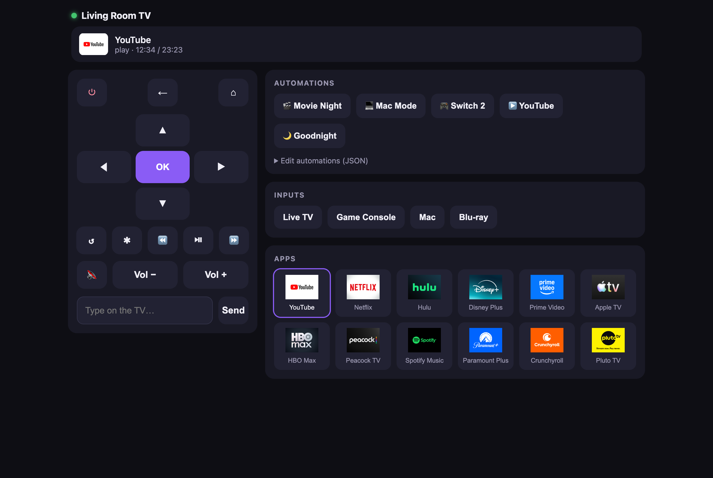
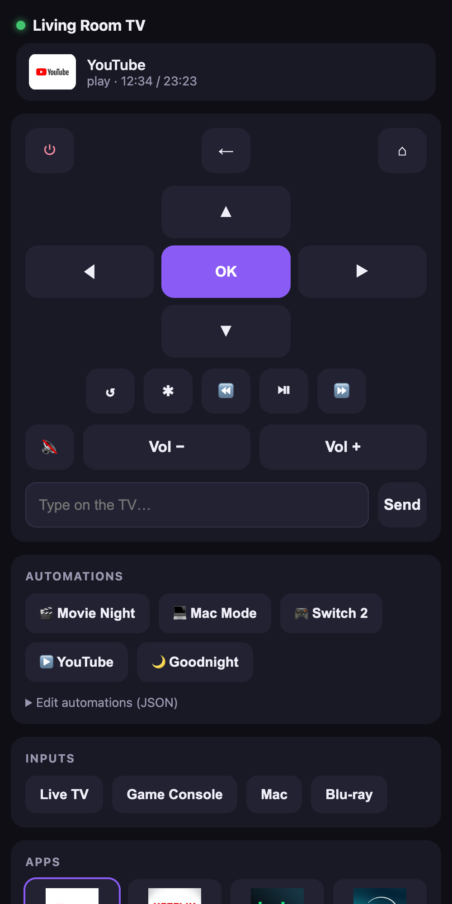
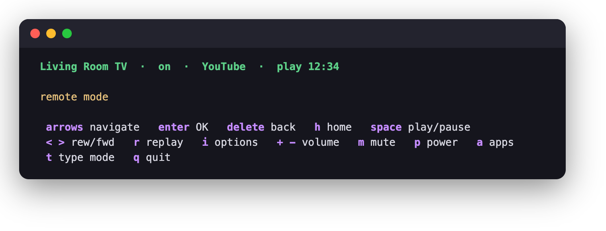
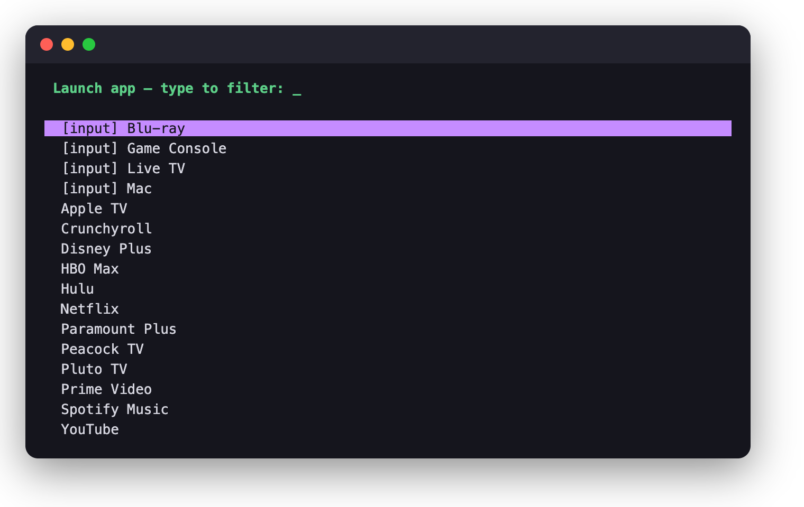

# Roku LAN Remote

Self-hosted web remote, live status dashboard, and automation runner for Roku
TVs, plus a terminal (TUI) remote. **Zero dependencies** — Python 3 standard
library only. Talks to the TV via Roku's built-in
[External Control Protocol](https://developer.roku.com/dev/docs/external-control-api)
(ECP, port 8060), the same API the official mobile app uses.

- **Live status** — power, active app + icon, play/pause, position
- **Full remote** — d-pad, playback, volume, power; works *inside* apps
  (YouTube, Netflix, …)
- **App launcher** — every channel with its real icon, one-tap input
  switching (HDMI, AV, tuner)
- **Text sender** — type into TV search/login keyboards
- **Automations** — macro sequences, editable in the UI, each triggerable
  via a plain HTTP call
- **TUI** — a curses terminal remote, no server needed

<p align="center">
  
  
</p>

## Prerequisites

- Roku TV/player and host computer on the same network.
- Python 3.9+ on the host (preinstalled on macOS). Nothing to `pip install`.
- On the TV: **Settings → System → Advanced system settings → Control by
  mobile apps → Network access → Default** (no developer mode needed).

## Quick start

```sh
git clone https://github.com/ajarteag/roku-lan-remote.git
cd roku-lan-remote
python3 discover.py --save   # find the TV, write its IP to config.json
python3 server.py            # serve the web remote (prints its URLs)
```

- Open `http://<host-ip>:8000` from any device on the network.
- iPhone: Share → **Add to Home Screen** for a fullscreen, app-like remote.
- Desktop keys: arrows navigate · Enter OK · Backspace back · Esc home ·
  Space play/pause.
- Discovery searches every network interface. If it finds nothing, force a
  subnet with `python3 discover.py --subnet 192.168.4 --save`, or copy the
  TV's IP (**Settings → Network → About**) into `config.json`.

## Terminal remote (TUI)

```sh
python3 roku_tui.py          # uses tv_ip from config.json; or --ip 192.168.1.50
```

- One-word launch: `alias tv='python3 ~/path/to/roku-lan-remote/roku_tui.py'`
- Keys: arrows navigate · enter OK · delete back · `h` home ·
  space play/pause · `<`/`>` rew/fwd · `r` replay · `i` options ·
  `+`/`-` volume · `m` mute · `p` power · `a` app picker · `t` type mode ·
  `^d` dictate · `q` quit

### Dictation (macOS)

In type mode, press `ctrl-d` to speak instead of type — handy for search
boxes. Transcription runs on-device via Apple's speech recognizer through
the [`hear`](https://sveinbjorn.org/hear) CLI (the TUI itself stays
zero-dependency; it just shells out):

```sh
brew install sveinbjornt/hear/hear   # or grab the prebuilt binary from the site
```

- While dictating: the live transcript is shown; enter stops, esc cancels.
- By default you then review the text — enter sends it to the TV as
  keystrokes, esc discards, `ctrl-d` re-records.
- To skip the review and send as soon as you stop: `--dictate send`, or set
  `"dictation_send": "send"` in `config.json`.
- First use prompts for microphone + speech-recognition permission for your
  terminal app. Linux/Windows: the TUI works as before; dictation shows a
  "macOS only" hint.

<p align="center">
  
  
</p>

## Hotkey window (macOS)

The same remote as the TUI (identical keys, type mode, app picker,
dictation) in a small window you summon from anywhere with a global hotkey.
It stays running with no Dock icon; the hotkey shows it and gives it focus.

```sh
./install-gui-macos.sh       # builds ~/Applications/Roku Remote.app, starts it at login
```

- Default hotkey **cmd+shift+u**; change it with `"hotkey"` in `config.json`
  (e.g. `"ctrl+opt+r"`), then re-run the installer. A global hotkey takes
  the combo away from every app: ⌘⇧U only costs VS Code's Output panel and
  Finder's Go → Utilities, while ⌘⇧T / ⌘⇧R would break browser shortcuts.
- Hide: the hotkey again, `esc` (in remote mode), `q`, or ⌘W. Quit: ⌘Q.
- No Accessibility / Input Monitoring permission needed: the hotkey uses
  Carbon's `RegisterEventHotKey`. If macOS asks to find devices on your
  local network, click Allow (that's how it reaches the TV).
- Without installing: `python3 roku_gui.py` (shows the running instance if
  there is one) · `python3 roku_gui.py --toggle` for other hotkey tools.
- Logs: `gui.log` · remove: `./install-gui-macos.sh --uninstall`

## Automations

`macros.json` holds a list of `{name, icon, steps}`, editable in the web UI
under *Automations → Edit*. Steps run in order:

- `{"type": "keypress", "value": "PowerOn"}` — any ECP key
  (`Home`, `Select`, `VolumeUp`, `PowerOff`, …)
- `{"type": "launch", "value": "12"}` — app ID or TV input
  (`tvinput.hdmi1`, …); `GET /api/apps` lists your IDs
- `{"type": "delay", "value": 2000}` — milliseconds (max 30000)

Each macro is an HTTP endpoint, so Apple Shortcuts, Siri, Raycast, cron, or
Home Assistant can trigger it:

```sh
curl -X POST "http://<host-ip>:8000/api/macro/Movie%20Night"
```

## API

| Route | Description |
|---|---|
| `GET /api/status` | power, active app, play state, position |
| `GET /api/apps` | installed apps + inputs, with launch IDs |
| `POST /api/keypress/<key>` | press a remote key |
| `POST /api/launch/<id>` | launch an app or switch input |
| `POST /api/text` | body `{"text": "hello"}` — types on the TV |
| `GET/POST /api/macros` | read / replace the automation list |
| `POST /api/macro/<name>` | run one automation |

## Host it permanently (macOS)

On an always-on machine (Mac mini/Studio, NAS, Pi):

- Clone the repo and run `python3 discover.py --save` once.
- Give the host a static IP / DHCP reservation in your router.
- Run `./install-macos.sh` from the repo directory. It registers a launchd
  service (starts on boot, restarts on crash) using the port from
  `config.json`; logs go to `server.log`.
- Approve the one-time macOS prompt to allow Python to accept local
  network connections.
- Re-run the script after changing `config.json`; remove with
  `./install-macos.sh --uninstall`. (Linux: a systemd unit running
  `python3 server.py`.)

## A memorable URL (`http://tv.lan`)

Give the host a name in your router's local DNS so nobody types IPs.
`<host-ip>` below is the LAN IP of the machine running `server.py` — find it
with `ipconfig getifaddr en0` (or the router's Clients page). If the host is
on more than one network, use its IP on the **TV's router**.

On GL.iNet / OpenWrt routers (dnsmasq):

- Reserve `<host-ip>`: admin panel → **Clients** → the host → *Modify* →
  bind the IP.
- Add the DNS record — SSH to the router and run:

  ```sh
  uci add dhcp domain
  uci set dhcp.@domain[-1].name='tv.lan'
  uci set dhcp.@domain[-1].ip='<host-ip>'
  uci commit dhcp && /etc/init.d/dnsmasq restart
  ```

  (Or in LuCI: **Network → DHCP and DNS → Hostnames** → Add.)
- For a bare `http://tv.lan` (no port): set `"server_port": 80` in
  `config.json` and re-run `./install-macos.sh`; otherwise use
  `http://tv.lan:8000`.

Notes:

- Use a dotted name like `tv.lan` — Apple devices (Safari, all iOS browsers)
  won't resolve single-label names like `http://tv`.
- Don't use a dnsmasq wildcard (`address=/tv/...`) — it would capture real
  `.tv` internet domains (including roku.tv) for the whole network.
- On the first visit type `tv.lan/` (with the slash) so the browser treats
  it as a site, not a search.
- No-router-config alternative: set the host's local hostname to `tv`
  (System Settings → General → Sharing) and use `http://tv.local:8000`.

## Repo layout

- `server.py` — web server + ECP proxy (stdlib only)
- `static/` — the web UI
- `roku_core.py` — shared remote logic: ECP client, dictation, key bindings
- `roku_tui.py` — terminal remote (curses front end for roku_core)
- `roku_gui.py` — hotkey window (Tk front end for roku_core, macOS)
- `macos/launcher.swift`, `install-gui-macos.sh` — Roku Remote.app wrapper
- `discover.py` — find Rokus on the LAN, `--save` writes `config.json`
- `config.json` — TV IP, server port, GUI hotkey
- `macros.json` — automation definitions

## How it works

Roku devices expose a plain HTTP API on port 8060 (ECP): `POST /keypress/<key>`
presses remote buttons (which is why navigation works inside any app),
`POST /launch/<id>` opens apps and inputs, and `GET /query/*` reports device,
app, and playback state. `server.py` proxies those endpoints, parses the XML
into JSON, and serves the single-page UI in `static/`. The TUI and hotkey
window talk to the TV directly.

Not possible by design: screenshots/video of protected app content (Roku only
allows screen capture for sideloaded dev channels), and there's no clean API
for arbitrary TV settings — only what's reachable via remote keys.
